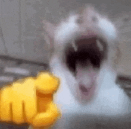

# nice-try

> A screen locker with a sense of humor, for the coworker who can't keep their hands off your unattended PC.

<p align="center">
  
</p>

Run it, walk away. Your screen looks exactly like your normal desktop, but it's actually a frozen screenshot.
The moment someone moves the mouse, clicks, or presses a key, every monitor switches to a big **"Nice try :D"**
with a laughing GIF, and a few seconds later the PC really locks itself.

## How it works

1. Takes a screenshot of every connected monitor.
2. Covers each monitor with a borderless, always-on-top window showing that screenshot, so it looks like the real desktop.
3. Waits for a short grace period (so you can step away without triggering it yourself).
4. After that, any mouse movement, mouse click or key press triggers the gotcha screen.
5. The gotcha screen stays up for a few seconds, then the workstation is locked with `LockWorkStation`.

Screenshots are only kept in memory and never written to disk.

## Usage

Clone or download the repo and keep all the files in the same folder:

```
fake-desktop.ps1     the actual script
launch.vbs           runs the script without a console window
laughinggif2.gif     the image shown when someone gets caught
```

Then double-click **`launch.vbs`** and walk away.

You can also run the script directly (a console window will be visible):

```powershell
powershell -NoProfile -ExecutionPolicy Bypass -File .\fake-desktop.ps1
```

### Launch it with a keyboard shortcut

For a quick getaway, give it a hotkey so you can trigger it on your way out of your chair:

1. Right-click **`launch.vbs`** and pick **Send to → Desktop (create shortcut)**.
2. Right-click the new shortcut on your desktop and open **Properties**.
3. On the **Shortcut** tab, click the **Shortcut key** box and press the combo you want, e.g. `Ctrl + Alt + F`.
4. Click **OK**.

Now pressing that combo starts the fake desktop from anywhere. Windows only picks up shortcut keys for shortcuts
on the Desktop or in the Start Menu, so leave the shortcut there (moving it into the Start Menu folder works too).

### Secret exit

Press **`Ctrl + Alt + Q`** to close the fake desktop without the gotcha screen. The PC still goes straight to the
lock screen, just in case. This works at any time, including during the grace period and after someone got caught.

## Configuration

Tweak these at the top of `fake-desktop.ps1`:

| Variable   | Default                | Description                                                                 |
|------------|------------------------|-----------------------------------------------------------------------------|
| `$GRACE`   | `2`                    | Seconds after launch during which nothing triggers.                         |
| `$HOLD_MS` | `6000`                 | How long (ms) the gotcha screen stays up before the PC locks.               |
| `$IMAGE`   | `laughinggif2.gif`     | Image shown when triggered (png/jpg/gif, GIFs animate). If missing, only the text is shown. |

Mouse movement has to exceed 8 pixels before it counts, so a slightly bumped desk won't set it off.

## Requirements

- Windows 10 / 11
- Windows PowerShell 5.1 (built in) or PowerShell 7 on Windows

## Disclaimer

Made for fun. Only run it on your own machine. It doesn't block `Ctrl + Alt + Del` and it's not a replacement for
actually locking your PC (`Win + L`). It just makes the people who forget that feel a little silly.

## License

[MIT](LICENSE)
